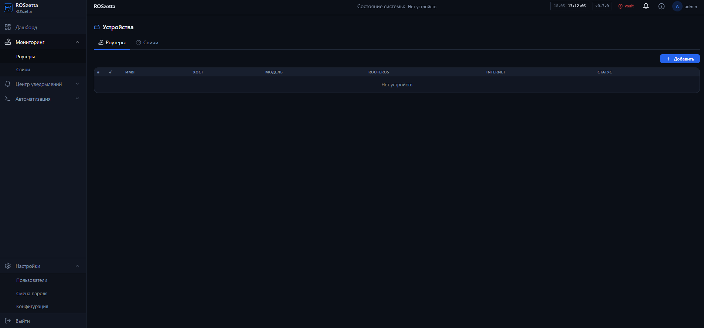
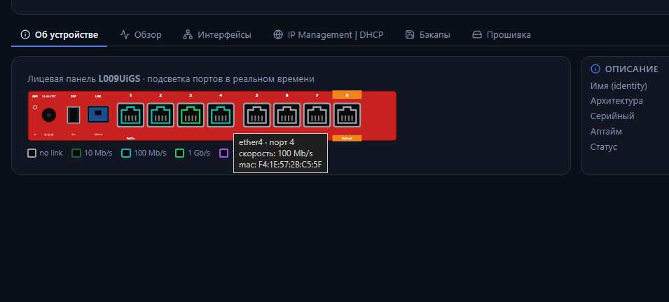

ROSzetta, централизованный контроллер для управления устройствами MikroTik.
Что умеет: — Центральное управление парком устройств — Мониторинг портов в реальном времени — Обновление прошивок — Автоматический сбор бэкапов — И многое другое — список растёт

ROSzetta Self-hosted web application for managing MikroTik device fleets. Monitor, configure, upgrade, and backup your devices from a single dashboard with real-time updates.

## Screenshots

  

  

---

## ❤️ Поддержать ROSzetta

ROSzetta — бесплатный проект с открытым исходным кодом для управления и автоматизации MikroTik RouterOS.

Если проект оказался полезным, вы можете поддержать дальнейшую разработку через Telegram Wallet.

### 💎 Донаты через TON

**Адрес кошелька в сети TON:**

UQAB8xTyQuoX-a4rIV4dEMqN9dtjKqufBm1bN86LJFxXTgB3

**Важно:** используйте только поддерживаемые кошельком криптовалюты и сети.

Спасибо за поддержку ROSzetta! ❤️

